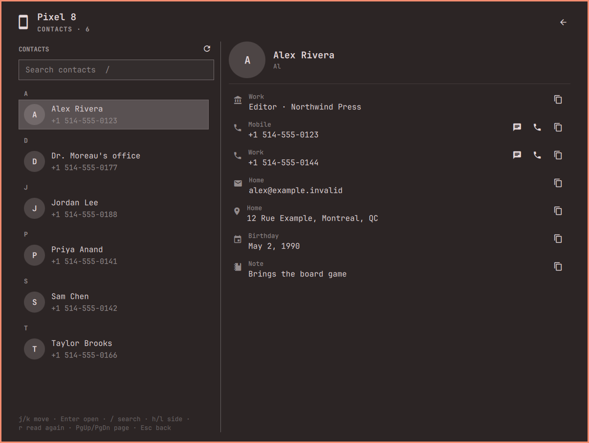

[Devices](../../README.md) › Use it › Contacts

# Contacts

The phone's address book, read on your desktop: every card with all of
its numbers, emails, addresses, websites, birthday and note, in two panes like
[Messages](messages.md), with search. Read-only: a change is made on the
phone.

Add the *Contacts* [shortcut](shortcuts.md) to open it. A card's *Message*
starts a [text](messages.md) to that number; *Call* opens the dialer on
the phone, and the call itself stays your tap there. An email opens your
mail app, an address Omarchy's Google Maps, a website your browser, and
the panel closes behind it. *Copy* takes any detail. A button opens the
contacts app Omarchy ships (Google Contacts), while this computer still
has it, and the panel closes behind it. It holds only your Google
account's contacts: a card the phone keeps for itself says *On the phone
only*; any other card has a button to find it there.

The phone sends its cards when the panel opens on the page, at most every
five minutes; `r` asks again. Away, the cards already here still read, and
*Call* waits for the phone. The card last open comes back, per device.

## Their conversation

A card shows your three latest texts with that person under its details;
each opens the conversation on that message. The conversation button (or
`m`) opens it at its newest, or starts a new message when there is none.
Back returns to the card. Whatever opens a card lands on it: selected, in
view, marked by a short pulse.

## Keys

| Key | Action |
|---|---|
| `j` `k` · `g` `G` | Move · first, last |
| `l` `h` | Into the card · back |
| Enter | Open a card; on a detail: *Message* on a number, open an email, address or website, else copy |
| `/` · `r` | Search · read again |
| `m` | Their conversation |
| Esc · `0` | Back to where you came from · Home |

Setup: [Contacts](../setup/contacts.md) · Limits: [What it cannot do](../setup/limits-contacts.md)
