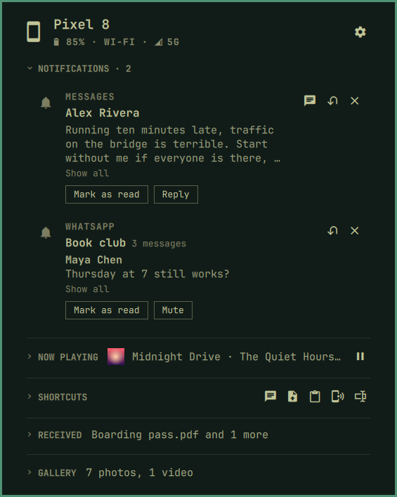

[Devices](../../README.md) › Use it › Notifications

# Notifications

Every notification the phone shows, here as the phone shows it, and
answered without touching it: reply, dismiss, or press the app's own
buttons, from your keyboard.

- **A chat** shows who said what, and *Show all* opens the rest.
- **Many from one app** stack under a title (*3 from Calendar*) with the
  newest shown. Click it, or press `l`, to open the rest; `h` folds it.
  A chat keeps its own stack per conversation. The button on the title
  dismisses the whole stack on the phone; a notification's own ✕ dismisses
  just that one.
- **Reply** right there (`r`), with the app's own *Mark as read* or *Mute*
  beside it. **Dismiss** here dismisses on the phone too (`x`), and the
  button by the section's title dismisses them all.
- **A text** opens its conversation in [Messages](messages.md). **Any
  other app** opens in a window here (`o`): [Apps](apps.md).
- **Not here:** what the phone itself hides, and a player's playback
  notification, which is the [Now playing](now-playing.md) card instead.

## Keys

| Key | Action |
|---|---|
| `r` · `x` · `e` | Reply · dismiss · show all |
| `l` · `h` | Open · fold a stack |
| `Shift+Delete` | Dismiss all |
| `o` | Open its app in a window |

Setup: [Your devices](../setup/devices.md) · Limits: [What it cannot do](../setup/limits.md)
